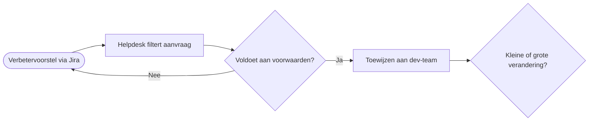

# BPMN

> Business Process Model and Notation: de standaardnotatie om bedrijfsprocessen te tekenen. In de Agentic AI-tasks is een BPMN-analyse van een interview de rode draad om LLM's, prompts, agents en MCP-servers te vergelijken.

## Basiselementen
| Element | Symbool | Betekenis |
|---|---|---|
| **Pool / lane** | Rechthoekige baan | Organisatie / rol (bv. helpdesk, ontwikkelteam, domeinexpert) |
| **Activiteit (task)** | Afgeronde rechthoek | Werk dat iemand doet |
| **Gateway** | Ruit (X = exclusief, + = parallel) | Beslissing of splitsing |
| **Startgebeurtenis** | Dunne cirkel | Begin van het proces |
| **Eindgebeurtenis** | Dikke cirkel | Einde |
| **Sequence flow** | Volle pijl | Volgorde binnen een pool |
| **Message flow** | Stippellijn | Communicatie tussen pools |

## Het interview in de tasks (samengevat)
Een ziekenhuis meldt een verbetervoorstel via Jira → **helpdesk** filtert (voldoende info? juiste prioriteit? zo niet → terug naar ziekenhuis) → toewijzen aan **development-team** → teamlead schat in: **klein of groot**?
- Klein → team beslist zelf (backlog of afwijzen).
- Groot → **domeinexpert** schat de nood in en bespreekt met de **product lead manager** → doorgaan? → **werkgroep** met andere ziekenhuizen geeft feedback → beslissing → inplannen op roadmap/planningslijst → ontwikkelen & testen → productie → aanvraag afsluiten.
- Niet uitgevoerd → aanvraag direct afgesloten.
- In beide gevallen wordt de aanvrager verwittigd.

## Waarom AI hierbij?
LLM's kunnen een interview omzetten naar actoren, activiteiten en gateways, een renderbare flowchart maken (bv. Mermaid) en **vervolgvragen** voorstellen. Maar: ze kunnen stappen verzinnen of gateways missen → vergelijk altijd met het origineel ([[Primary source]]) en met een handgemaakt diagram.

## Mermaid-voorbeeld (begin)

## Gerelateerd
[[Prompt engineering]] · [[Task 1.1 - BPMN-prompt in twee LLMs vergelijken]] · [[Task 2.1 - OpenCode met Plan en Build mode]] · [[Task 3.1 - BPMN-analyse met MCP-servers]]

---
Hoort bij: [[Module 1 - Definitions, terms & prompting]] · [[Module 2 - Harness & Agentic AI]] · [[Module 3 - Context]]
