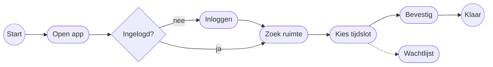

# User flow

> Het **pad** dat een gebruiker in je app neemt om één specifiek doel te bereiken (bv. inloggen, een product kopen). Toont de stappen, beslissingen en interacties.

## Notatie
| Vorm | Betekenis |
|---|---|
| ⚪ **Cirkel** | Start- of eindpunt (of verwijzing naar een andere flow) |
| 💊 **Pil-vorm** (afgeronde rechthoek) | Scherm of actie |
| 🔷 **Diamant** | Beslissingspunt (ja/nee, ingelogd?) |
| ➡️ **Pijl** | Route |
| ⇢ **Gestreepte pijl** | Alternatieve route |

## Voorbeeld: ruimte reserveren

## Current state vs. future state
- **Current state**: hoe het nu werkt in de bestaande app. Noteer er [[Pijnpunt]]en, ideeën en opvallende momenten bij. Dit maak je in [[Groepsopdracht 1 - Gebruikersanalyse]].
- **Future state**: je verbeterde flow, die je daarna uitwerkt als [[Wireframe]] en [[Prototype]].

## Verschil met journey
Zie [[User journey map]]: journey = hele ervaring met gevoel, flow = concreet pad door schermen.

---
Hoort bij: [[Gebruikersanalyse]] · [[Wireframing & Prototyping]]
